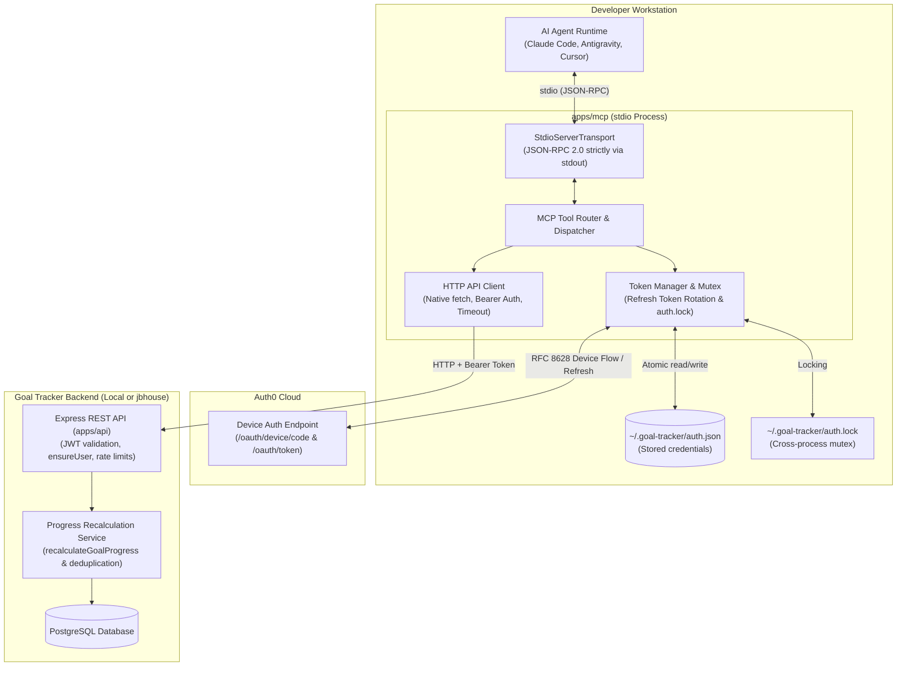

# Goal Tracker Local Stdio MCP Server (`apps/mcp`)

*   **Author:** bishesh
*   **Status:** Draft
*   **Date:** 2026-11-17

--------------------------------------------------------------------------------

## Overview

Goal Tracker Local MCP Server is a Node.js daemon package (`apps/mcp`) inside the Goal Tracker monorepo. It implements the Model Context Protocol (MCP) over standard input/output (`stdio`), allowing AI agents (such as Claude Code, Cursor, Antigravity, and Codex) to view, create, modify, complete, and schedule goals and tasks through natural language.

The server authenticates against Auth0 using the OAuth 2.0 Native Device Authorization Grant (RFC 8628). This allows the user to log in once via their browser (`https://bises.auth0.com/activate`), caching rotating credentials in `~/.goal-tracker/auth.json`. Rather than accessing the database directly, the MCP server acts as an authenticated client proxy to Goal Tracker's existing Express REST API. This reuses all existing business rules, input validation, soft deletes, and automatic goal progress recalculations across both local development environments (`localhost:3000`) and the home server deployment on `jbhouse` (`100.115.237.63:3000` via Tailscale).

## The Problem

Goal Tracker currently provides a web client (`apps/web`) and a REST backend (`apps/api`). When developers use AI coding assistants or autonomous agent workflows to plan schedules, track daily commitments, or align tasks with long-term milestones, there is no direct interface for the agent to inspect or update Goal Tracker:

1. **Lack of Agent Integration**: Agents cannot inspect upcoming deadlines, mark completed tasks, or organize hierarchical goals without manual copy-pasting between the chat pane and the web UI.
2. **Authentication Barrier for Autonomous Tools**: Goal Tracker uses Auth0 JWT bearer tokens with user-specific `sub` claims. Standard Machine-to-Machine (M2M) credentials do not link to the user's personal goals and tasks, while browser Single Page Application (SPA) authentication cannot run inside headless CLI processes.
3. **Business Logic Fragmentation Risk**: Connecting an agent directly to the PostgreSQL database via Prisma would bypass the Express API layer. This would bypass route-level validation, omit audit metadata, and bypass the relational progress recalculation and task deduplication logic established in PR #64.

## Goals

*   **Monorepo Integration**: Establish `apps/mcp` as a standalone TypeScript package in the pnpm workspace, bundled with `tsup` for cold startup times under 150ms.
*   **Delegated Auth0 Authentication (RFC 8628)**: Implement interactive CLI authentication (`pnpm --filter mcp login`, `status`, `logout`) that obtains access and refresh tokens without requiring hardcoded client secrets or user passwords.
*   **Secure Local Credential Management**: Store rotated tokens in `~/.goal-tracker/auth.json` with cross-process file-lock synchronization (`~/.goal-tracker/auth.lock`) to prevent Auth0 token reuse detection faults during concurrent agent executions.
*   **Proxy-Based Tool Architecture**: Expose high-level semantic tools (`manage_goals`, `manage_tasks`, `link_task_to_goal`, `get_calendar_agenda`, `get_system_status`) that invoke the Express REST API over HTTP, maintaining identical validation and progress recalculation behavior.
*   **Dual-Environment Target Routing**: Support dynamic environment selection between local development (`http://localhost:3000`) and the home server deployment (`http://100.115.237.63:3000`) via `GOAL_TRACKER_API_URL`.
*   **Stdio Protocol Purity**: Direct all JSON-RPC 2.0 communication exclusively through `stdout`, while routing all logging, debug output, and interactive authentication URLs strictly to `stderr`.

## Non-Goals

*   **Remote HTTP/SSE Endpoint Hosting**: The MCP server will not run as an open HTTP or Server-Sent Events daemon on the network; it runs strictly as a local `stdio` subprocess spawned by IDE agent clients.
*   **Direct Database Mutations via Prisma**: The MCP server will not connect directly to PostgreSQL or define Prisma client bindings; all operations must traverse Express routes.
*   **Mobile App Proxying**: Mobile clients (such as the standalone `Goal-Tracker-Android` app) will not communicate with or route through the MCP server.
*   **Machine-to-Machine (M2M) Impersonation**: M2M service tokens will not be used, avoiding administrative impersonation complexity.

## Open Questions

*   **Question 1**: Should the local token cache in `~/.goal-tracker/auth.json` support multi-profile configurations (e.g. separate tokens for local development vs. production), or is a single authenticated user profile sufficient?
*   **Question 2**: For batch task operations (e.g. rescheduling 5 tasks at once), should the server offer a dedicated `batch_reschedule_tasks` tool, or should the agent invoke `manage_tasks` sequentially?

## Critical User Journeys (CUJs)

### CUJ 1: Initial Developer Login via Terminal
*   **Given**: A developer has cloned the monorepo and wants to enable agent access.
*   **When**: The developer runs `pnpm --filter mcp login` in the terminal.
*   **Then**: The CLI requests a device code from Auth0, prints the verification URL and code to `stderr`, opens the browser to `https://bises.auth0.com/activate`, polls until confirmation, and saves the tokens to `~/.goal-tracker/auth.json`.

### CUJ 2: Agent Queries Goals and Plans Daily Tasks via stdio
*   **Given**: An AI assistant (e.g. Claude Code or Antigravity) is configured with `apps/mcp` in its MCP configuration.
*   **When**: The user prompts the agent: *"What are my active weekly goals, and what tasks are scheduled for today?"*
*   **Then**: The agent launches the MCP server over `stdio`. The MCP server loads the cached token, queries `GET /api/goals` and `GET /api/tasks?date=YYYY-MM-DD`, and returns structured Markdown results to the agent.

### CUJ 3: Agent Mutates State with Identical Business Rules
*   **Given**: The user asks the agent to create a task linked to an existing goal and mark an existing task complete.
*   **When**: The agent calls `manage_tasks` with action `create` and `goalId`, followed by action `complete` on the target task ID.
*   **Then**: The MCP server calls `POST /api/tasks` and `POST /api/tasks/:id/complete`. The backend executes `recalculateGoalProgress`, updates goal task ratios without double-counting, and returns the updated progress to the agent.

### CUJ 4: Token Expiration During Headless Agent Execution
*   **Given**: The access token has expired and the refresh token is revoked or invalidated.
*   **When**: An agent invokes an MCP tool.
*   **Then**: The MCP server attempts a refresh. Upon failure, the server spawns the browser with `verification_uri_complete` and immediately returns a structured tool error response (`isError: true`) with instructions to the user, preventing an unhandled crash or indefinite hang on `stdio`.


--------------------------------------------------------------------------------

## Technical Plan (Architecture)

### System Architecture Overview

The Goal Tracker MCP architecture operates as a thin client proxy between local LLM agent runtimes and Goal Tracker's backend infrastructure.



### Component Breakdown

#### 1. CLI Router & Entrypoint (`src/index.ts`, `bin/goal-tracker-mcp.js`)
*   **Command Modes**:
    *   `goal-tracker-mcp login`: Triggers the interactive Device Authorization Flow, displays the verification URL and code to `stderr`, opens the browser, polls for tokens, and exits with status 0 upon success.
    *   `goal-tracker-mcp status`: Inspects the local token file, verifies token expiration, validates API reachability, and prints user claims (`sub`, `email`, `name`) and API version to `stderr`.
    *   `goal-tracker-mcp logout`: Purges `~/.goal-tracker/auth.json` and cleanly clears active sessions.
    *   `goal-tracker-mcp` (default with no arguments): Initializes the Model Context Protocol stdio server and attaches tool handlers.
*   **Stdio Isolation Guard**: Overrides `console.log` during server mode to route any accidental output to `process.stderr`, ensuring `process.stdout` remains pristine for JSON-RPC framing.

#### 2. Auth0 Device Flow & Token Management Subsystem (`src/auth/`)
*   **`deviceFlow.ts`**:
    *   Requests device code from `https://bises.auth0.com/oauth/device/code` with audience `https://goal-tracker-api`, client ID, and scopes `openid profile email offline_access`.
    *   Outputs `verification_uri_complete` and opens the default browser using the `open` package.
    *   Polls `https://bises.auth0.com/oauth/token` at the interval instructed by Auth0 (default 5s) handling `authorization_pending`, `slow_down`, `expired_token`, and `access_denied`.
*   **`tokenStore.ts`**:
    *   Resolves cross-platform config directory (`process.env.USERPROFILE` on Windows, `process.env.HOME` on POSIX) targeting `~/.goal-tracker/auth.json`.
    *   Enforces secure file creation permissions (`0700` directory, `0600` file on POSIX; restricted file ACLs on Windows).
    *   Implements atomic file writes (writing to temporary file and replacing) to eliminate file corruption.
*   **`tokenManager.ts`**:
    *   Maintains an in-memory token cache.
    *   Checks token expiration timestamp before every API request with a 60-second safety buffer.
    *   When expired, coordinates token refresh using Auth0's Refresh Token Rotation grant (`grant_type=refresh_token`).
    *   Acquires a cross-process lock (`~/.goal-tracker/auth.lock`) with exponential backoff.
    *   Prior to dispatching the refresh request to Auth0, checks if `auth.json` on disk was refreshed by another process within the last 30 seconds; if so, loads the newly issued token without triggering a duplicate refresh.

#### 3. HTTP API Client (`src/client/apiClient.ts`)
*   **Configuration**: Resolves API base URL from `GOAL_TRACKER_API_URL` (defaulting to `http://localhost:3000`).
*   **Transport**: Uses native Node.js 18+ global `fetch` with `AbortSignal.timeout(5000)` to prevent unbounded hangs if a remote host (`100.115.237.63:3000`) is unreachable over Tailscale.
*   **Authorization**: Attaches `Authorization: Bearer <accessToken>` dynamically via `tokenManager.getValidAccessToken()`.
*   **Error Normalization**: Maps HTTP status codes into typed exceptions (`GoalTrackerApiError`, `AuthenticationError`, `NotFoundError`, `ValidationError`). 

#### 4. MCP Server & Tool Definitions (`src/server.ts`, `src/tools/`)
The server instantiates `McpServer` from `@modelcontextprotocol/sdk` and exposes 5 consolidated semantic tools with strict Zod validation schemas:

```typescript
// 1. Goal Management Tool
manage_goals({
  action: z.enum(["list", "get", "create", "update", "delete"]),
  id: z.string().optional(),
  title: z.string().optional(),
  scope: z.enum(["YEARLY", "MONTHLY", "WEEKLY", "STANDALONE"]).optional(),
  type: z.enum(["TOTAL_TARGET", "FREQUENCY"]).optional(),
  targetValue: z.number().optional(),
  frequencyTarget: z.number().optional(),
  frequencyType: z.enum(["DAILY", "WEEKLY", "MONTHLY"]).optional(),
  startDate: z.string().regex(/^\d{4}-\d{2}-\d{2}$/).optional(),
  endDate: z.string().regex(/^\d{4}-\d{2}-\d{2}$/).optional(),
  parentGoalId: z.string().optional()
});

// 2. Task Management Tool
manage_tasks({
  action: z.enum(["list", "get", "create", "update", "delete", "complete", "uncomplete"]),
  id: z.string().optional(),
  title: z.string().optional(),
  description: z.string().optional(),
  priority: z.enum(["HIGH", "MEDIUM", "LOW"]).optional(),
  category: z.enum(["WORK", "PERSONAL", "HEALTH", "LEARNING", "FINANCE", "SOCIAL", "HOUSEHOLD", "OTHER"]).optional(),
  scheduledDate: z.string().regex(/^\d{4}-\d{2}-\d{2}$/).optional(),
  size: z.number().optional(),
  goalId: z.string().optional(),
  status: z.enum(["completed", "pending"]).optional(),
  date: z.string().regex(/^\d{4}-\d{2}-\d{2}$/).optional(),
  unscheduled: z.boolean().optional(),
  month: z.string().regex(/^\d{4}-\d{2}$/).optional()
});

// 3. Goal-Task Association Tools
link_task_to_goal({
  taskId: z.string(),
  goalId: z.string()
});

unlink_task_from_goal({
  taskId: z.string(),
  goalId: z.string()
});

// 4. Calendar View Tool
get_calendar_agenda({
  startDate: z.string().regex(/^\d{4}-\d{2}-\d{2}$/),
  endDate: z.string().regex(/^\d{4}-\d{2}-\d{2}$/),
  includeUnscheduled: z.boolean().optional(),
  parentGoalId: z.string().optional()
});

// 5. System Status Tool
get_system_status();
```

### Stdio & Transport Invariants

1. **Protocol Stream Partitioning**:
   - `process.stdout`: Strictly reserved for the MCP JSON-RPC 2.0 communication channel. No library or application log may emit characters here.
   - `process.stderr`: Diagnostic and user guidance channel. Used for device login URLs, error diagnostics, and Tailscale connection warnings.
2. **Error Serialization**:
   - HTTP errors, schema violations, and authentication prompts are caught and converted into JSON-RPC tool result objects with `isError: true` and Markdown formatted message content. The stdio process never terminates or throws uncaught exceptions during tool invocations.

### Concurrency & Cross-Process Locking Model

To guarantee that multiple IDE agent processes (e.g. Claude Code in terminal and Cursor in editor) running simultaneously do not invalidate Auth0 refresh tokens:
1. When token expiration is detected, the process attempts to acquire an exclusive lock file at `~/.goal-tracker/auth.lock` using atomic `fs.open(..., 'wx')`.
2. If locked, the process waits with jittered polling (100–300ms) up to 5 seconds.
3. Once the lock is acquired, the process re-reads `~/.goal-tracker/auth.json`. If another process completed the refresh within the past 30 seconds, the new token is used immediately, skipping the Auth0 network call.
4. If still expired, the process calls Auth0 `/oauth/token`, atomically writes the new token and rotated refresh token to `auth.json`, and releases the lock file in a `finally` block.


--------------------------------------------------------------------------------

## Alternatives Considered

### Alternative 1: Remote HTTP/SSE MCP Server Hosted on `jbhouse`

*   **Mechanism**: Host the MCP server as an always-on Docker container on the home server alongside `apps/api`, exposing Model Context Protocol over HTTP Server-Sent Events (SSE).
*   **Pros**:
    *   Centralized service deployment with no local Node.js process spawned on the developer workstation.
    *   Accessible across multiple local machines without running local server binaries.
*   **Cons**:
    *   **Security & Credential Exposure**: If the remote server holds the user's Auth0 credentials in configuration, any client reaching the network port acts as the user without boundary checks. If the client must pass bearer tokens with every HTTP connection, many current IDE agents (which expect local `stdio` processes) cannot supply dynamic per-user OAuth tokens.
    *   **Network Dependency**: Fails completely when working offline or when disconnected from the Tailscale VPN.
*   **Reason for Rejection**: Rejected by author: Exposing personal user permissions over a remote HTTP daemon creates unnecessary network security risks and client configuration friction compared to a local `stdio` subprocess.

### Alternative 2: Direct Database Access via Prisma in the MCP Server

*   **Mechanism**: Import Prisma ORM and the PostgreSQL schema directly into `apps/mcp`, bypassing the Express REST API entirely and executing queries directly against the database using a hardcoded or configured `userId`.
*   **Pros**:
    *   Eliminates HTTP serialization overhead and network hops.
    *   Does not require Auth0 token generation, device flows, or refresh token management.
*   **Cons**:
    *   **Progress Calculation Divergence**: Express API routes enforce complex relational business logic, specifically single-source-of-truth progress recalculation (`recalculateGoalProgress`), parent-child task deduplication, and cascading delete ordering established in PR #64. Re-implementing or bypassing this in an MCP package risks corrupting goal progress ratios.
    *   **Security & Audit Bypass**: Direct database queries bypass route middleware (`ensureUser`, request validation, and sanitized error logging).
*   **Reason for Rejection**: Rejected by author: Bypassing the Express API layer duplicates business logic and introduces a severe risk of database progress state divergence between the web UI and the AI agent.

### Alternative 3: Auth0 Machine-to-Machine (M2M) Client Credentials Flow

*   **Mechanism**: Register a Machine-to-Machine Application in Auth0 with a static `client_id` and `client_secret` to obtain server-level JWTs.
*   **Pros**:
    *   Purely autonomous authentication without interactive browser prompts.
    *   No refresh tokens or local credential caching required.
*   **Cons**:
    *   **Identity Mismatch**: In Goal Tracker, all goals, milestones, and tasks are strictly partitioned by the user's unique Auth0 identity (`sub: "auth0|..."`). An M2M token represents an autonomous machine service rather than a human user, meaning the token would see zero user records unless administrative user impersonation was architected into the API.
    *   **Secret Management**: Distributing a shared `client_secret` across local developer workstations violates public client security best practices.
*   **Reason for Rejection**: Rejected by author: M2M tokens do not map to the human user's account records, and storing client secrets in local CLI tools is insecure.

### Alternative 4: Fine-Grained 1:1 REST-to-MCP Tool Exposure (15+ Tools)

*   **Mechanism**: Map every individual REST endpoint (e.g. `get_task`, `create_task`, `patch_task`, `delete_task`, `complete_task`, `uncomplete_task`, `get_goal`, `create_goal`, etc.) to a separate MCP tool.
*   **Pros**:
    *   Simple 1:1 mapping directly reflecting backend router files.
*   **Cons**:
    *   **Token Overhead**: Exposing 15+ tool definitions injects thousands of tokens into every LLM prompt context window.
    *   **Agent Decision Latency**: LLMs struggle with tool selection accuracy when overloaded with minor micro-tools, frequently selecting incorrect granular endpoints for compound operations.
*   **Reason for Rejection**: Rejected by author: Semantic grouping (`manage_tasks`, `manage_goals`) significantly reduces context token consumption and simplifies agent planning while preserving full operational capability.


--------------------------------------------------------------------------------

## Non-Functional Requirements

### Security & Privacy
*   **Zero Embedded Secrets**: The MCP server operates as an OAuth 2.0 Public Client (Native Application). It embeds no client secrets or API keys.
*   **Credential Protection**: The token cache directory `~/.goal-tracker/` and file `auth.json` are created with restricted permissions (`0700` and `0600` on POSIX; restricted user ACLs on Windows).
*   **Token Refresh Rotation**: The client strictly adheres to Auth0 Refresh Token Rotation (RTR). Every token refresh operation atomically writes the new refresh token to disk and purges the old token from memory.
*   **Stdio Leak Prevention**: Sensitive tokens are never printed to `stdout` or `stderr`. Logging sanitization prevents logging full bearer tokens in error traces.

### Performance & Latency
*   **Fast Cold Startup**: The bundle is compiled into a single executable `dist/index.js` using `tsup`. Cold startup time is bounded under 150ms to ensure responsive agent startup in IDEs.
*   **Fail-Fast Remote Timeouts**: HTTP requests to `GOAL_TRACKER_API_URL` use an explicit 5-second connection timeout (`AbortSignal.timeout(5000)`). If the home server on `jbhouse` is unreachable over Tailscale, the server fails fast with diagnostic guidance rather than hanging agent workflows.

### Rollout & Backward Compatibility
*   **Additive Package Architecture**: The new `apps/mcp` package is isolated from existing `apps/web` and `apps/api` packages. It introduces zero changes to existing database models, migrations, or Express routes.
*   **Workspace Dependency Alignment**: Consumes `@goal-tracker/shared` via `workspace:*` to maintain guaranteed type alignment without version skew.

--------------------------------------------------------------------------------

## Detailed Implementation Plan

### Target Files to Create/Modify

#### 1. `apps/mcp/package.json` (Create)
*   **Type / Scope**: Package Configuration
*   **Proposed Changes**:
    *   Define package name `@goal-tracker/mcp`, version `1.0.0`, private `true`.
    *   Add executable binary mapping: `"bin": { "goal-tracker-mcp": "./bin/goal-tracker-mcp.js" }`.
    *   Declare dependencies: `@modelcontextprotocol/sdk`, `@goal-tracker/shared` (`workspace:*`), `zod`, `open`, `dotenv`.
    *   Declare dev dependencies: `tsup`, `typescript`, `@types/node`, `jest`, `ts-jest`, `@types/jest`.
    *   Define scripts: `build` (`tsup`), `dev` (`tsup --watch`), `lint` (`eslint src/`), `test` (`jest`), `type-check` (`tsc --noEmit`).

#### 2. `apps/mcp/tsconfig.json` (Create)
*   **Type / Scope**: TypeScript Compiler Configuration
*   **Proposed Changes**:
    *   Extend `../../tsconfig.base.json`.
    *   Set `target: "ES2022"`, `module: "NodeNext"`, `moduleResolution: "NodeNext"`.
    *   Set `outDir: "./dist"`, `rootDir: "./src"`.
    *   Enable strict type checking and declaration generation.

#### 3. `apps/mcp/tsup.config.ts` (Create)
*   **Type / Scope**: Bundler Configuration
*   **Proposed Changes**:
    *   Configure `tsup` entry at `src/index.ts`.
    *   Target `node18`, format `cjs` (or `esm` with node resolution), minify `false`, sourcemap `true`.
    *   Add banner `#!/usr/bin/env node` to output bundle.
    *   Clean `dist/` before each build.

#### 4. `apps/mcp/bin/goal-tracker-mcp.js` (Create)
*   **Type / Scope**: Executable Wrapper
*   **Proposed Changes**:
    *   Provide entrypoint executing `../dist/index.js` with proper Node flags.

#### 5. `apps/mcp/src/config.ts` (Create)
*   **Type / Scope**: Configuration Module
*   **Proposed Changes**:
    *   Export `CONFIG`:
        *   `apiUrl`: `process.env.GOAL_TRACKER_API_URL || 'http://localhost:3000'`
        *   `auth0Domain`: `process.env.AUTH0_DOMAIN || 'bises.auth0.com'`
        *   `auth0ClientId`: `process.env.AUTH0_CLIENT_ID || 'goal-tracker-mcp-client-id'`
        *   `auth0Audience`: `process.env.AUTH0_AUDIENCE || 'https://goal-tracker-api'`
        *   `configDir`: Path to `~/.goal-tracker/` (cross-platform resolution)
        *   `authFilePath`: Path to `~/.goal-tracker/auth.json`
        *   `lockFilePath`: Path to `~/.goal-tracker/auth.lock`

#### 6. `apps/mcp/src/auth/deviceFlow.ts` (Create)
*   **Type / Scope**: Authentication Service
*   **Proposed Changes**:
    *   Function `initiateDeviceFlow()`: POST to `https://${auth0Domain}/oauth/device/code` with client ID, scope (`openid profile email offline_access`), audience (`https://goal-tracker-api`).
    *   Prints verification instructions and code to `process.stderr`.
    *   Invokes system browser to `verification_uri_complete` using `open`.
    *   Function `pollForToken(deviceCode, interval, expiresIn)`: Polls `https://${auth0Domain}/oauth/token` handling standard RFC 8628 states (`authorization_pending`, `slow_down`, `expired_token`). Returns token payload.

#### 7. `apps/mcp/src/auth/tokenStore.ts` (Create)
*   **Type / Scope**: Storage Utility
*   **Proposed Changes**:
    *   Interface `TokenData`: `{ accessToken, refreshToken, expiresAt, tokenType, scope, user: { sub, email, name } }`.
    *   Function `loadTokens()`: Reads and parses `auth.json`. Returns `null` if file missing or corrupt.
    *   Function `saveTokens(tokens)`: Ensures `~/.goal-tracker/` exists with `0700` permissions. Atomically writes `auth.json` with `0600` permissions.
    *   Function `clearTokens()`: Unlinks `auth.json` if present.

#### 8. `apps/mcp/src/auth/tokenManager.ts` (Create)
*   **Type / Scope**: Token Lifecycle & Concurrency Manager
*   **Proposed Changes**:
    *   Class `TokenManager`:
        *   `getValidAccessToken()`: Returns cached access token if valid (>60s before `expiresAt`).
        *   If expired, coordinates refresh:
            1. Acquires file lock on `auth.lock` with retry and timeout.
            2. Re-reads `auth.json` to verify if another process refreshed within 30s.
            3. If still expired, POST to `https://${auth0Domain}/oauth/token` with `grant_type=refresh_token`.
            4. Atomically writes new token set to disk.
            5. Releases `auth.lock`.
        *   Throws `AuthRequiredError` if refresh token is missing or revoked.

#### 9. `apps/mcp/src/client/apiClient.ts` (Create)
*   **Type / Scope**: HTTP API Client
*   **Proposed Changes**:
    *   Class `GoalTrackerApiClient`:
        *   Wraps Node global `fetch` with `AbortSignal.timeout(5000)`.
        *   Injects `Authorization: Bearer <token>` from `tokenManager`.
        *   Provides typed methods:
            *   `listGoals(params)` -> `GET /api/goals`
            *   `getGoal(id)` -> `GET /api/goals/:id`
            *   `createGoal(data)` -> `POST /api/goals`
            *   `updateGoal(id, data)` -> `PATCH /api/goals/:id`
            *   `deleteGoal(id)` -> `DELETE /api/goals/:id`
            *   `listTasks(params)` -> `GET /api/tasks`
            *   `getTask(id)` -> `GET /api/tasks/:id`
            *   `createTask(data)` -> `POST /api/tasks`
            *   `updateTask(id, data)` -> `PATCH /api/tasks/:id`
            *   `deleteTask(id)` -> `DELETE /api/tasks/:id`
            *   `completeTask(id)` -> `POST /api/tasks/:id/complete`
            *   `uncompleteTask(id)` -> `POST /api/tasks/:id/uncomplete`
            *   `getCalendarAgenda(startDate, endDate)` -> `GET /api/calendar`
            *   `getHealth()` -> `GET /health`
            *   `getMe()` -> `GET /api/auth/me`

#### 10. `apps/mcp/src/client/errors.ts` (Create)
*   **Type / Scope**: Error Types
*   **Proposed Changes**:
    *   Define `GoalTrackerApiError`, `AuthRequiredError`, `NotFoundError`, `ValidationError`, and `NetworkTimeoutError`.

#### 11. `apps/mcp/src/tools/goals.ts` (Create)
*   **Type / Scope**: MCP Tool Handler
*   **Proposed Changes**:
    *   Registers `manage_goals` with `McpServer`.
    *   Validates input schema with Zod.
    *   Dispatches to `apiClient`.
    *   Formats returned goals into concise Markdown tables/lists with hierarchical progress ratios (`currentValue/targetValue`).

#### 12. `apps/mcp/src/tools/tasks.ts` (Create)
*   **Type / Scope**: MCP Tool Handler
*   **Proposed Changes**:
    *   Registers `manage_tasks`, `link_task_to_goal`, `unlink_task_from_goal`.
    *   Validates input schema with Zod.
    *   Dispatches to `apiClient`.
    *   Formats task lists with status badges (`[x]` / `[ ]`), priority indicators (`HIGH`, `MEDIUM`, `LOW`), scheduled dates, and associated goals.

#### 13. `apps/mcp/src/tools/calendar.ts` (Create)
*   **Type / Scope**: MCP Tool Handler
*   **Proposed Changes**:
    *   Registers `get_calendar_agenda`.
    *   Aggregates tasks by scheduled date.
    *   Renders daily agenda breakdown in Markdown.

#### 14. `apps/mcp/src/tools/system.ts` (Create)
*   **Type / Scope**: MCP Tool Handler
*   **Proposed Changes**:
    *   Registers `get_system_status`.
    *   Returns connected API URL, API health, version, authenticated user name and email.

#### 15. `apps/mcp/src/server.ts` (Create)
*   **Type / Scope**: MCP Server Runtime
*   **Proposed Changes**:
    *   Instantiates `McpServer({ name: "goal-tracker", version: "1.0.0" })`.
    *   Registers all tools.
    *   Attaches `StdioServerTransport`.
    *   Redirects `console.log` to `console.error` to safeguard `process.stdout`.

#### 16. `apps/mcp/src/index.ts` (Create)
*   **Type / Scope**: CLI Entrypoint & Router
*   **Proposed Changes**:
    *   Parses CLI arguments (`process.argv`):
        *   `login`: Executes `deviceFlow.ts` and exits.
        *   `status`: Prints connection and token status to `stderr` and exits.
        *   `logout`: Clears stored tokens and exits.
        *   No argument: Launches `server.ts` over `stdio`.

#### 17. `apps/mcp/src/__tests__/tokenManager.test.ts` (Create)
*   **Type / Scope**: Unit Test
*   **Proposed Changes**:
    *   Test in-memory token cache retrieval.
    *   Test expired token triggers Auth0 refresh mock.
    *   Test cross-process lock file handling and 30-second freshness bypass.

#### 18. `apps/mcp/src/__tests__/apiClient.test.ts` (Create)
*   **Type / Scope**: Unit Test
*   **Proposed Changes**:
    *   Mock Node `fetch` responses.
    *   Verify `Authorization: Bearer` header injection.
    *   Verify error mapping on 401, 404, and 500 status codes.

#### 19. `package.json` (Modify)
*   **Type / Scope**: Monorepo Root Configuration
*   **Proposed Changes**:
    *   Add root script: `"mcp": "pnpm --filter @goal-tracker/mcp"`.
    *   Add root script: `"mcp:login": "pnpm --filter @goal-tracker/mcp login"`.

#### 20. `CLAUDE.md` (Modify)
*   **Type / Scope**: Project Developer Guide
*   **Proposed Changes**:
    *   Add section on MCP server usage and commands.
    *   Provide example `.mcp.json` / Claude Desktop configuration snippet.

#### 21. `.mcp.json` (Modify)
*   **Type / Scope**: Workspace MCP Configuration
*   **Proposed Changes**:
    *   Register `"goal-tracker"` in root `.mcp.json` pointing to `node apps/mcp/dist/index.js`.

---

### Verification Plan

*   **Compilation / Build**:
    *   Command: `pnpm --filter @goal-tracker/mcp build`
    *   Success criteria: `tsup` bundles `src/index.ts` into `dist/index.js` with zero TypeScript or bundler errors.
*   **Unit Tests**:
    *   Command: `pnpm --filter @goal-tracker/mcp test`
    *   Success criteria: Jest passes 100% of test suites covering `tokenManager` and `apiClient`.
*   **Static Analysis & Linting**:
    *   Command: `pnpm run lint` and `pnpm run type-check`
    *   Success criteria: Zero ESLint warnings or errors, clean TypeScript strict mode verification.
*   **Integration & End-to-End Verification**:
    1. **Interactive Login Verification**: Run `pnpm mcp:login`, verify terminal displays Auth0 device code, opens browser to `https://bises.auth0.com/activate`, and successfully saves tokens to `~/.goal-tracker/auth.json`.
    2. **Status Check**: Run `pnpm --filter @goal-tracker/mcp status`, confirm valid token and successful health check against `http://localhost:3000`.
    3. **Live Agent Tool Calling**: Configure MCP in Antigravity/Claude, issue prompt *"List my current weekly goals and tasks for today"*, verify tool execution over `stdio`, and confirm returned task lists match database ground truth.
    4. **Mutating Operation Check**: Issue prompt *"Create task 'Verify MCP Agent Integration' with HIGH priority for today linked to my active weekly goal"*, confirm task is created via `POST /api/tasks`, and verify goal progress ratio updates properly.
