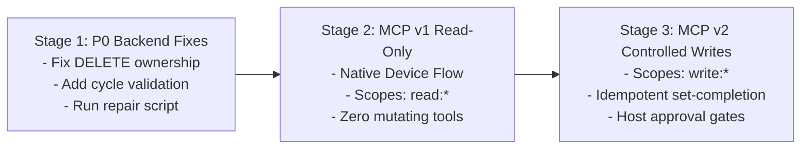
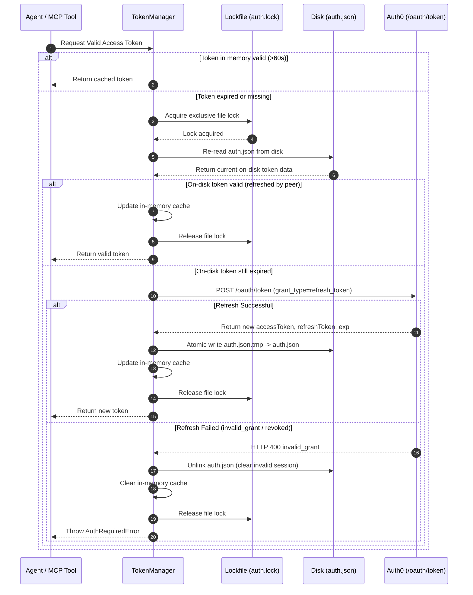

# Goal Tracker Local Stdio MCP Server (`apps/mcp`)

*   **Author:** bishesh
*   **Status:** In Review
*   **Date:** 2026-11-17
*   **Revision:** v2.0 (Security Hardened & API Aligned)

--------------------------------------------------------------------------------

## Overview

Goal Tracker Local MCP Server is a Node.js daemon package (`apps/mcp`) inside the Goal Tracker monorepo. It implements the Model Context Protocol (MCP) over standard input/output (`stdio`), enabling AI coding assistants and autonomous agents (such as Claude Code, Cursor, Antigravity, and Codex) to inspect, organize, and plan goals, daily tasks, and calendar schedules directly through natural language.

The architecture is built on five core operational pillars:
1. **API-First Ownership & Cascade Integrity**: Hardens existing Express endpoints before MCP rollout, eliminating a cross-user deletion vulnerability in `DELETE /api/goals/:id`, validating ownership and cycle freedom on all hierarchy updates, and aligning with Prisma's hard-delete cascade model.
2. **Phased Action Scoping (Read-Only v1)**: Restricts initial deployment strictly to read-only tools enforced by Auth0 API scopes (`read:goals`, `read:tasks`, `read:calendar`). Mutation tools are staged for v2 with human-in-the-loop approval gates. Goal and task deletion is permanently excluded from autonomous agent capabilities.
3. **Environment-Bound Credential Profiles**: Establishes isolated profiles (`development` vs. `production`) with dedicated API origins, distinct Auth0 audiences to prevent cross-environment token replay, certificate-validated HTTPS over Tailscale, and automated rejection of HTTP redirects.
4. **Coordinated Credential Synchronization**: Implements cross-process file locking (`auth-<profile>.lock`) with in-lock freshness checks, atomic replacement, and automated recovery from stale locks, crashes, and simultaneous token rotations. Headless agent processes never spawn browser sessions.
5. **Exact REST Contract Alignment**: Bridges MCP tools directly to actual Express routes (`PUT /api/goals/:id`, `PUT /api/tasks/:id`, `GET /api/calendar/tasks`, array `goalIds`), introducing an idempotent completion endpoint (`POST /api/tasks/:id/set-completion`) to make network retries safe.

--------------------------------------------------------------------------------

## The Problem

Goal Tracker currently provides a React web client (`apps/web`), an Express REST backend (`apps/api`), and a standalone Android application (`bises/Goal-Tracker-Android`). When developers interact with AI agents to plan schedules or review commitments, several security and architectural obstacles arise:

1. **Backend Cross-Account Security Flaws**:
   - `DELETE /api/goals/:id` performs an initial lookup for `where: { id, userId: user.id }` solely to capture the parent goal ID. If the goal belongs to another user (or is missing), the query returns null, but execution continues into `tx.progress.deleteMany({ where: { goalId: id } })` and `tx.goal.delete({ where: { id } })`. An authenticated user can delete another user's goal and progress records by ID.
   - Goal updates (`PUT /api/goals/:id`) and task updates (`PUT /api/tasks/:id`) accept `parentId` and `parentTaskId` without validating caller ownership or checking for cycles, allowing cross-account hierarchy grafting and recursive loops.
2. **Uncontrolled Agent Mutation & Injection Vulnerability**: Exposing full write and delete capabilities to autonomous agents creates high blast-radius risks. Untrusted goal titles or task descriptions can act as indirect prompt injection vectors. Deletion of parent goals triggers cascading deletes across child goals and goal-task associations.
3. **Token Replay & Network Exposure**: Reusing tokens across local development and production home-server deployments on `jbhouse` risks sending production credentials over unencrypted local channels or replaying development tokens against production data.
4. **Auth0 Refresh Token Rotation Race Conditions**: Autonomous agents launching multiple parallel processes (e.g., Claude Code in terminal alongside Cursor in IDE) trigger simultaneous token refreshes. With Auth0 Refresh Token Rotation (RTR), whichever process sends an already-rotated token triggers *Reuse Detection*, immediately invalidating all active sessions for that user.

--------------------------------------------------------------------------------

## Goals

*   **P0 Backend Security Hardening**: Ship a standalone backend fix for `DELETE /api/goals/:id` and parent ownership/cycle validation in `PUT /api/goals/:id` and `PUT /api/tasks/:id` before deploying the MCP server.
*   **Enforced Read-Only v1 Scope**: Restrict the v1 MCP server strictly to read tools (`list_goals`, `get_goal`, `list_tasks`, `get_calendar_agenda`, `get_system_status`) enforced by Auth0 scopes (`read:goals`, `read:tasks`, `read:calendar`).
*   **Idempotent Task Completion**: Introduce `POST /api/tasks/:id/set-completion` accepting `{ isCompleted: boolean }` so agent retries after network timeouts do not toggle task states or create duplicate progress logs.
*   **Isolated Environment Profiles**: Bind CLI credentials to explicit profiles (`development` vs. `production`) with distinct Auth0 audiences, origin validation, certificate-checked HTTPS over Tailscale, and redirect rejection.
*   **Deterministic Credential Lifecycle**: Implement an atomic cross-process file lock (`auth-<profile>.lock`) that re-reads on-disk credentials under the lock, recovers from stale locks, handles simultaneous rotation, and prevents headless browser spawns.
*   **Stdio Protocol Purity**: Guarantee `stdout` is exclusively reserved for valid JSON-RPC 2.0 frames, routing all diagnostics, warnings, and recovery instructions strictly to `stderr`.

## Non-Goals

*   **Agent Deletion Tools (Permanent Non-Goal)**: Neither v1 nor v2 will expose `delete_goal` or `delete_task` to AI agents. Deletions must be performed directly by the human user through the web or mobile UI.
*   **Agent Mutations in v1**: Write tools (`create_task`, `update_task`, `set_task_completion`, `create_goal`, `update_goal`) are deferred to Rollout Stage 3.
*   **Direct Database Mutations via Prisma**: The MCP package will not bundle Prisma client or connect directly to PostgreSQL.
*   **Mobile App Proxying**: Mobile clients continue connecting directly to the Express REST API.
*   **Headless Browser Authentication**: The MCP server will never trigger browser launches from stdio tool calls. Browser authentication is initiated solely by explicit interactive terminal commands (`goal-tracker-mcp login`).

--------------------------------------------------------------------------------

## Critical User Journeys (CUJs)

### CUJ 1: Developer Interactive Terminal Login
*   **Given**: A developer wishes to grant local agent access to the production environment on `jbhouse`.
*   **When**: The developer executes `pnpm --filter @goal-tracker/mcp login --profile production`.
*   **Then**: The CLI validates configuration, initiates the RFC 8628 Device Authorization Flow with Auth0 using audience `https://goal-tracker-api`, displays the 8-character user code and verification URL to `stderr`, opens the default system browser, polls until approval, and atomically writes credentials to `~/.goal-tracker/auth-production.json`.

### CUJ 2: Agent Queries Agenda in Read-Only Mode (v1)
*   **Given**: An AI assistant is configured with `apps/mcp` targeting the production profile.
*   **When**: The user asks: *"What tasks are scheduled for today, and what active weekly goals do they support?"*
*   **Then**: The agent launches `goal-tracker-mcp` over `stdio`. The server loads `auth-production.json`, calls `GET /api/goals` and `GET /api/calendar/tasks`, strips control characters, formats Markdown tables, and returns the result with zero mutating side effects.

### CUJ 3: Attempted Write with v1 Read-Only Token
*   **Given**: A compromised or misconfigured agent runtime attempts to issue an HTTP `PUT` or `POST` using a v1 MCP token.
*   **When**: The request hits Express with scopes `read:goals read:tasks read:calendar`.
*   **Then**: The Express `requireScope(['write:tasks'])` middleware rejects the request with HTTP 403 Forbidden. The database remains completely untouched.

### CUJ 4: Headless Tool Call with Expired Credentials
*   **Given**: The user has logged out or their Auth0 refresh token has expired.
*   **When**: The AI agent calls `manage_tasks` over `stdio`.
*   **Then**: The MCP server detects that local credentials cannot be refreshed. It does NOT spawn a browser or block. It immediately returns an error payload (`isError: true`) with the message: *"Stored credentials for profile 'production' are missing or expired. Run 'pnpm --filter @goal-tracker/mcp login --profile production' in your terminal to authenticate."*

### CUJ 5: Concurrent Process Refresh and Token Rotation
*   **Given**: Cursor and Claude Code execute MCP tools simultaneously while the cached access token is expired.
*   **When**: Both processes attempt token refresh.
*   **Then**: Process A acquires `auth-production.lock`. Process B waits on the lock. Process A calls Auth0 `/oauth/token`, atomically saves the new rotated refresh token and access token, and releases the lock. Process B acquires the lock, re-reads `auth-production.json` under the lock, detects valid credentials, and proceeds without calling Auth0, preventing reuse detection faults.

--------------------------------------------------------------------------------

## 1. Backend Ownership Hardening & Cascade Integrity

### 1.1 The `DELETE /api/goals/:id` Defect & Fix

#### Defect Analysis
In `apps/api/src/routes/goals.ts`:
```typescript
// VULNERABLE CODE (Current)
const goal = await tx.goal.findFirst({
  where: { id, userId: user.id },
  select: { parentId: true },
});
await tx.progress.deleteMany({ where: { goalId: id } });
await tx.goal.delete({ where: { id } });
```
When a caller provides an ID belonging to another user, `goal` resolves to `null`. The transaction continues and executes `tx.progress.deleteMany` and `tx.goal.delete` using the un-scoped `id`. This permits any authenticated user to destroy another user's goal and progress records.

#### Concrete Solution
Rewrite `DELETE /api/goals/:id` to enforce strict ownership verification before any mutation:
```typescript
// REMEDIATED CODE
router.delete('/:id', async (req, res) => {
  const { id } = req.params;
  try {
    const user = await ensureUser(req);

    await prisma.$transaction(async (tx: Prisma.TransactionClient) => {
      // 1. Ownership check: Must match both id and userId
      const goal = await tx.goal.findFirst({
        where: { id, userId: user.id },
        select: { id: true, parentId: true },
      });

      // 2. Fail fast: Stop immediately if missing or owned by another user
      if (!goal) {
        const error = new Error('Goal not found or access denied');
        (error as any).statusCode = 404;
        throw error;
      }

      // 3. Atomically delete progress and goal
      await tx.progress.deleteMany({ where: { goalId: goal.id } });
      await tx.goal.delete({ where: { id: goal.id } });

      // 4. Recalculate parent goal progress if this was a child goal
      if (goal.parentId) {
        await recalculateGoalProgress(goal.parentId, tx);
      }
    });

    res.json({ message: 'Goal deleted' });
  } catch (error: any) {
    if (error.statusCode === 404) {
      return res.status(404).json({ error: error.message });
    }
    console.error(error instanceof Error ? error.message : 'Unknown error');
    res.status(500).json({ error: 'Failed to delete goal' });
  }
});
```

### 1.2 Prisma Cascade Reality vs. Soft-Delete Correction
*The previous design erroneously asserted that Goal Tracker uses soft deletes (`isDeleted`).* 
**Ground Truth**: `apps/api/prisma/schema.prisma` defines **hard deletes with PostgreSQL relational cascades**:
*   `Goal.parentId`: `onDelete: Cascade`. Deleting a goal automatically hard-deletes all descendant child goals recursively.
*   `Progress.goalId`: `onDelete: Cascade`. Deleting a goal hard-deletes all associated progress log entries.
*   `GoalTask.goalId`: `onDelete: Cascade`. Deleting a goal deletes the junction associations. Underlying `Task` records are preserved.
*   `GoalTask.taskId`: `onDelete: Cascade`. Deleting a task deletes junction associations. Underlying `Goal` records are preserved.
*   `Task.parentTaskId`: `onDelete: Cascade`. Deleting a task hard-deletes all nested subtasks recursively.

Because goal deletion cascades downward to child goals and unlinks tasks, autonomous deletion by agents represents an unacceptable risk. Goal deletion is permanently excluded from MCP agent tooling.

### 1.3 Hierarchy Ownership & Cycle Prevention

#### Goal Reparenting (`PUT /api/goals/:id` & `POST /api/goals`)
When `parentId` is supplied:
1.  **Ownership Check**: Query `tx.goal.findFirst({ where: { id: parentId, userId: user.id } })`. If null, reject with HTTP 400 (`'Parent goal not found or access denied'`).
2.  **Self-Parenting Check**: If `parentId === id`, reject with HTTP 400 (`'Goal cannot be its own parent'`).
3.  **Cycle Detection**: Traverse ancestors of `parentId`. If any ancestor ID matches `id`, reject with HTTP 400 (`'Cyclic goal hierarchy detected'`).
```typescript
async function assertGoalCycleFree(goalId: string, targetParentId: string, userId: number, tx: Prisma.TransactionClient): Promise<void> {
  let currentParentId: string | null = targetParentId;
  const visited = new Set<string>([goalId]);

  while (currentParentId) {
    if (visited.has(currentParentId)) {
      throw new ValidationError('Cyclic goal hierarchy detected: target parent is a descendant of this goal');
    }
    visited.add(currentParentId);

    const ancestor = await tx.goal.findFirst({
      where: { id: currentParentId, userId },
      select: { parentId: true },
    });
    if (!ancestor) {
      throw new ValidationError('Parent goal not found or access denied');
    }
    currentParentId = ancestor.parentId;
  }
}
```

#### Task Reparenting (`PUT /api/tasks/:id` & `POST /api/tasks`)
When `parentTaskId` is supplied:
1.  **Ownership Check**: Query `tx.task.findFirst({ where: { id: parentTaskId, userId: user.id } })`. If null, reject with HTTP 400 (`'Parent task not found or access denied'`).
2.  **Self-Parenting Check**: If `parentTaskId === id`, reject with HTTP 400 (`'Task cannot be its own parent'`).
3.  **Cycle Detection**: Traverse ancestor chain of `parentTaskId`. If any ancestor ID matches `id`, reject with HTTP 400 (`'Cyclic task hierarchy detected'`).

### 1.4 Existing Cross-Account Link Detection & Repair Script
Create `apps/api/src/scripts/auditAndRepairOwnership.ts`:
1.  **Orphaned Goal Reparenting**: Find all goals where `parentId IS NOT NULL` and `Goal.userId != parent.userId`. Set `parentId = NULL` and log finding.
2.  **Orphaned Task Reparenting**: Find all tasks where `parentTaskId IS NOT NULL` and `Task.userId != parentTask.userId`. Set `parentTaskId = NULL` and log finding.
3.  **Cross-Account GoalTask Associations**: Find all `GoalTask` records where `Goal.userId != Task.userId`. Delete the `GoalTask` rows and call `recalculateGoalProgress` for affected goals.

### 1.5 Two-Account Acceptance Test Cases
Unit/Integration test suite in `apps/api/src/__tests__/ownershipSecurity.test.ts`:
*   `Case 1 (Delete Isolation)`: User A creates Goal A. User B attempts `DELETE /api/goals/:idA`. API returns 404. Goal A and its progress remain intact in database.
*   `Case 2 (Goal Reparenting Isolation)`: User A creates Goal A. User B attempts `PUT /api/goals/:idB` with `parentId: idA`. API returns 400. Goal B `parentId` remains null.
*   `Case 3 (Task Reparenting Isolation)`: User A creates Task A. User B attempts `PUT /api/tasks/:idB` with `parentTaskId: idA`. API returns 400. Task B `parentTaskId` remains null.
*   `Case 4 (Cycle Rejection)`: User A creates Goal A -> Child Goal B. User A attempts `PUT /api/goals/:idA` with `parentId: idB`. API returns 400. Hierarchy remains acyclic.
*   `Case 5 (Tree Read Isolation)`: User A creates Goal A. User B queries `GET /api/goals/tree` and `GET /api/calendar/tasks`. Output contains strictly User B records with zero leakage of User A IDs, titles, or progress.

### 1.6 Standalone Backend Shipping Order
This backend ownership remediation is a prerequisite for MCP and must be released first:
*   **PR 1 (Backend P0)**: `fix(api): owner-scoped goal deletion, hierarchy cycle validation, and ownership repair script`. (Ships to `jbhouse` production before MCP client configuration).

--------------------------------------------------------------------------------

## 2. Agent Action Scoping & Phased Rollout

### 2.1 API-Enforced Scopes & Middleware Architecture
Auth0 permissions are defined on API `https://goal-tracker-api`:
*   `read:goals`: Read access to goal metadata, progress, and trees.
*   `read:tasks`: Read access to tasks, categories, priorities, and schedules.
*   `read:calendar`: Read access to scheduled calendar views.
*   `write:goals`: Permission to create and update goals.
*   `write:tasks`: Permission to create, update, complete, and link tasks.

#### Middleware Implementation (`apps/api/src/middleware/auth.ts`)
```typescript
import { claimCheck } from 'express-oauth2-jwt-bearer';

export const requireScope = (requiredScopes: string[]) => {
  return (req: Request, res: Response, next: NextFunction) => {
    const rawScope = (req.auth?.payload?.scope as string) || '';
    const grantedScopes = new Set(rawScope.split(' '));

    // Web SPA & Mobile backward compatibility:
    // If the token was issued to the legacy Web Client or Mobile Client ID
    // and lacks custom scopes, allow access to prevent breaking production callers.
    const clientId = req.auth?.payload?.azp;
    const isLegacyClient = clientId === process.env.AUTH0_WEB_CLIENT_ID || clientId === process.env.AUTH0_MOBILE_CLIENT_ID;

    if (isLegacyClient && !rawScope.includes(':')) {
      return next();
    }

    const hasAllScopes = requiredScopes.every((scope) => grantedScopes.has(scope));
    if (!hasAllScopes) {
      return res.status(403).json({
        error: 'Forbidden',
        message: `Missing required scope(s): ${requiredScopes.filter((s) => !grantedScopes.has(s)).join(', ')}`,
      });
    }
    next();
  };
};
```

### 2.2 Phased Rollout Stages



#### Stage 1: Backend Fixes & Scope Infrastructure
*   Ship ownership and cycle checks to `apps/api`.
*   Deploy `requireScope` middleware across API routes.
*   Configure Auth0 API permissions. Web and Android clients continue functioning uninterrupted.

#### Stage 2: MCP Server v1 (Read-Only)
*   Register only read tools:
    *   `list_goals`: Queries `GET /api/goals`.
    *   `get_goal`: Queries `GET /api/goals/:id`.
    *   `list_tasks`: Queries `GET /api/tasks`.
    *   `get_calendar_agenda`: Queries `GET /api/calendar/tasks`.
    *   `get_system_status`: Queries `GET /health` and `GET /api/auth/me`.
*   Auth0 Native Client configuration grants strictly `read:goals read:tasks read:calendar`.
*   Mutating tools do not exist in the codebase in this phase.

#### Stage 3: MCP Server v2 (Controlled Writes with Approval Gates)
*   Introduce mutation tools: `create_task`, `update_task`, `set_task_completion`, `create_goal`, `update_goal`, `link_task_to_goal`, `unlink_task_from_goal`.
*   Deletion tools remain permanently excluded.
*   **Host Approval Enforcement**: Mutating tools declare MCP annotations requesting user approval. In agent environments that support tool approval (Claude Code, Antigravity), users are prompted before changes are committed.
*   **Headless Safety Invariant**: In unmonitored headless agent runners (e.g. CI runners or automated scripts), the MCP server enforces an environment variable `GOAL_TRACKER_ALLOW_WRITES=true`. If unset or false, write calls return a structured error: `"Write operations disabled in headless mode. Set GOAL_TRACKER_ALLOW_WRITES=true to enable."`

### 2.3 Prompt Injection Defense & Data Sanitization
1.  **Untrusted Data Boundary**: Goal titles, task descriptions, notes, and customData labels are treated as untrusted user content.
2.  **Output Sanitization**:
    *   Control characters (`\x00-\x08`, `\x0B-\x1F`) are stripped from all string outputs.
    *   Special LLM delimiter tokens (`<|system|>`, `<|user|>`, `[INST]`, `</system>`) are escaped before serialization into tool result markdown.
    *   Text fields are formatted into markdown code blocks or blockquotes to clearly demarcate data from instructions.
3.  **Input Length Constraints on Writes (Stage 3)**:
    *   `title`: Max 255 characters, must not be empty.
    *   `description`: Max 4000 characters.
    *   `scheduledTime`: Regex `^([01]\d|2[0-3]):[0-5]\d$`.
    *   `date` strings: Regex `^\d{4}-\d{2}-\d{2}$`.

--------------------------------------------------------------------------------

## 3. Environment Profiles & Transport Security

### 3.1 Trusted Profile Matrix

| Attribute | Development Profile (`development`) | Production Profile (`production`) |
| :--- | :--- | :--- |
| **API Origin** | `http://localhost:3000` or `http://127.0.0.1:3000` | `https://100.115.237.63:3000` (or `https://goaltracker.home.arpa:3000`) |
| **Transport** | Plain HTTP allowed on loopback only | **Strict TLS 1.3 / HTTPS** (Certificate Validated) |
| **Auth0 Domain** | `bises.auth0.com` | `bises.auth0.com` |
| **Auth0 Audience** | `https://goal-tracker-api-dev` | `https://goal-tracker-api` |
| **Auth0 Client ID** | Dedicated Dev Native App ID | Dedicated Prod Native App ID |
| **Token Storage** | `~/.goal-tracker/auth-development.json` | `~/.goal-tracker/auth-production.json` |
| **Lock Storage** | `~/.goal-tracker/auth-development.lock` | `~/.goal-tracker/auth-production.lock` |

### 3.2 Transport Security & Redirect Rejection
*   **TLS Certificate Validation**: When targeting the production profile over Tailscale (`https://100.115.237.63:3000`), the client enforces standard TLS certificate validation against Node’s trusted CA bundle (using certificates issued via `tailscale cert`). Disabling TLS validation (`rejectUnauthorized: false`) is strictly prohibited.
*   **Automated Redirect Rejection**: In Node.js `fetch`, all authenticated requests set `redirect: 'error'`. If a server attempts an HTTP 301, 302, 307, or 308 redirect, the request immediately terminates. This prevents accidental transmission of Authorization headers to redirected or external URLs.

### 3.3 Token Replay Isolation
To guarantee development tokens cannot authenticate against the production home server:
1.  **Audience Binding**:
    *   Dev API verifies: `audience: "https://goal-tracker-api-dev"`
    *   Prod API verifies: `audience: "https://goal-tracker-api"`
2.  If an agent passes a development token to the production backend, `express-oauth2-jwt-bearer` rejects the token with HTTP 401 Unauthorized due to audience mismatch.

### 3.4 Auth0 Native Application Settings & Verification Checklist

- [ ] **Application Registration**:
  - Application Name: `Goal Tracker MCP (Production)`
  - Application Type: **Native**
  - Token Endpoint Authentication Method: `None`
- [ ] **Grant Types**:
  - Enable **Device Code** (`urn:ietf:params:oauth:grant-type:device_code`)
  - Enable **Refresh Token** (`refresh_token`)
- [ ] **API Access & Scopes**:
  - Authorize API: `https://goal-tracker-api`
  - Allow Offline Access: `true`
  - Allowed Permissions for v1: `read:goals`, `read:tasks`, `read:calendar`
- [ ] **Refresh Token Rotation Settings**:
  - Rotation: **Enabled**
  - Reuse Interval: `0 seconds` (Strict single-use rotation)
  - Inactivity Lifetime: 30 days
  - Absolute Lifetime: 90 days
- [ ] **Tenant Settings Verification (Pending Live Check)**:
  - Verify tenant-level Device Code user code format (Base20 vs. alphanumeric).
  - Confirm whether Auth0 Custom Domain is enabled or standard `bises.auth0.com` is required.

--------------------------------------------------------------------------------

## 4. Credential Lifecycle, Storage & Synchronization

### 4.1 Coordinated In-Lock Freshness (Replacing Fixed 30s Window)



#### Step-by-Step Mechanism
1.  **In-Memory Pre-Check**: If the in-memory access token is valid (current time `< expiresAt - 60_000ms`), return immediately.
2.  **Lock Acquisition**: Acquire `auth-<profile>.lock` using atomic `fs.open(lockPath, 'wx')`. If locked, poll every 100ms with jitter up to 10 seconds.
3.  **In-Lock Re-Read**: Read `auth-<profile>.json` directly from disk under the lock. If another process refreshed the token while this process waited, the on-disk access token will be valid. If valid, update in-memory cache, release lock, and return.
4.  **Auth0 Refresh Exchange**: If still expired, POST to `https://${auth0Domain}/oauth/token` with `grant_type=refresh_token`.
5.  **Atomic Persistence**: Write new tokens to `auth-<profile>.json.tmp.<pid>` and execute `fs.renameSync` over `auth-<profile>.json`.
6.  **Lock Release**: Delete `auth-<profile>.lock` in a `finally` block.

### 4.2 Storage Protections & Atomic Writes
*   **Directory Permissions**: `~/.goal-tracker/` created with `0700` (`rwx------`).
*   **File Permissions (POSIX)**: `auth-<profile>.json` created with `0600` (`rw-------`).
*   **File Permissions (Windows)**: Run PowerShell / `icacls` to strip inheritance and grant Full Control strictly to the owning user SID (`%USERNAME%:(OI)(CI)F`).
*   **Atomic Replacement**: Writes always target an ephemeral PID-tagged temporary file before atomic rename, preventing zero-byte file reads.

### 4.3 Stale Lock Recovery
The lock file contains JSON: `{ "pid": 1234, "timestamp": 1731800000000 }`.
If lock acquisition fails:
1.  Read the lock file.
2.  If `Date.now() - lock.timestamp > 15000` (15-second timeout):
    *   Check if `pid` is active using `process.kill(pid, 0)`.
    *   If process is dead or elapsed time exceeds 30 seconds, unlink the stale lock, log a diagnostic warning to `stderr`, and proceed to acquire.

### 4.4 Logout Synchronization & Process Observation
*   `goal-tracker-mcp logout --profile <profile>`:
    1. Acquires `auth-<profile>.lock`.
    2. Unlinks `auth-<profile>.json`.
    3. Releases lock and prints confirmation to `stderr`.
*   **Running Process Observation**: When an active stdio process attempts a token read and finds `auth-<profile>.json` missing, it purges its in-memory cache and throws `AuthRequiredError`. Subsequent tool calls fail fast without network attempts.

### 4.5 Refresh Failures, Network Timeouts & Revocation
*   **Crash/Timeout After Auth0 Rotates Token**: If Auth0 rotates the token but the process crashes before saving to disk, the old refresh token is transmitted on the next attempt. Auth0 triggers *Reuse Detection* and returns HTTP 400 `invalid_grant`.
*   **Actionable Error**: When Auth0 returns `invalid_grant`, the client unlinks `auth-<profile>.json` and throws `AuthRequiredError`.
*   **Access Token Lifetime vs. Refresh Revocation**: Access tokens are stateless JWTs. A revoked refresh token prevents *future* token issuances, but existing unexpired access tokens remain valid until their `exp` timestamp. The MCP client guarantees that once an explicit logout occurs, cached access tokens are purged from disk and memory immediately.
*   **Redacted Error Output**: When unauthenticated, tool calls return:
    ```json
    {
      "isError": true,
      "content": [
        {
          "type": "text",
          "text": "Authentication required. Stored credentials for profile 'production' are missing or revoked. Run 'pnpm --filter @goal-tracker/mcp login --profile production' in your terminal to authenticate."
        }
      ]
    }
    ```

--------------------------------------------------------------------------------

## 5. Tool-to-API Contract & Technical Specifications

### 5.1 Exact Repository Route & Method Mapping

| Operation | HTTP Method | Route Path | Request Payload / Query | Response Payload |
| :--- | :--- | :--- | :--- | :--- |
| **List Goals** | `GET` | `/api/goals` | `?scope=...&status=...` | `{ goals: Goal[] }` |
| **Get Goal** | `GET` | `/api/goals/:id` | None | `Goal` (with `children`, `goalTasks`) |
| **Create Goal** *(v2)* | `POST` | `/api/goals` | `{ title, description?, type?, targetValue?, frequencyTarget?, frequencyType?, endDate?, stepSize?, customDataLabel?, parentId?, scope? }` | `Goal` |
| **Update Goal** *(v2)* | `PUT` | `/api/goals/:id` | `{ title?, description?, targetValue?, frequencyTarget?, frequencyType?, endDate?, customDataLabel?, parentId?, scope? }` | `Goal` |
| **List Tasks** | `GET` | `/api/tasks` | `?status=...&date=YYYY-MM-DD&month=YYYY-MM&unscheduled=true&page=1&limit=50` | `Task[]` |
| **Get Task** | `GET` | `/api/tasks/:id` | None | `Task` (with `goalTasks`, `parentTask`, `subTasks`) |
| **Create Task** *(v2)* | `POST` | `/api/tasks` | `{ title, description?, size?, scheduledDate?, goalIds?: string[], parentTaskId?, customData?, priority?, category?, scheduledTime?, estimatedDurationMinutes?, estimatedCompletionDate? }` | `Task` |
| **Update Task** *(v2)* | `PUT` | `/api/tasks/:id` | `{ title?, description?, size?, scheduledDate?, parentTaskId?, customData?, isCompleted?, priority?, category?, scheduledTime?, estimatedDurationMinutes?, estimatedCompletionDate? }` | `Task` |
| **Set Task Completion** *(v2)* | `POST` | `/api/tasks/:id/set-completion` | `{ isCompleted: boolean }` | `Task` |
| **Get Calendar Agenda** | `GET` | `/api/calendar/tasks` | `?startDate=YYYY-MM-DD&endDate=YYYY-MM-DD&includeUnscheduled=true&parentGoalId=...` | `{ tasks: Task[] }` |
| **Get System Status** | `GET` | `/health` & `/api/auth/me` | None | Combined `{ status, version, user }` |

*Contract Corrections from Previous Draft*:
1.  Goal and Task updates use **`PUT`**, not `PATCH`.
2.  Calendar agenda uses **`GET /api/calendar/tasks`**, not `GET /api/calendar`.
3.  Task creation accepts **`goalIds: string[]`** (array), not scalar `goalId`.

### 5.2 Idempotent Task Completion Architecture
The existing `POST /api/tasks/:id/complete` endpoint toggles `isCompleted = !task.isCompleted`. If a client times out and retries, the task toggles back to incomplete and records conflicting progress entries.

#### Proposed Endpoint (`POST /api/tasks/:id/set-completion`)
```typescript
router.post('/:id/set-completion', async (req, res) => {
  try {
    const user = await ensureUser(req);
    const { isCompleted } = req.body;

    if (typeof isCompleted !== 'boolean') {
      return res.status(400).json({ error: 'Field isCompleted (boolean) is required' });
    }

    const task = await prisma.task.findFirst({
      where: { id: req.params.id, userId: user.id },
      include: { goalTasks: true },
    });

    if (!task) {
      return res.status(404).json({ error: 'Task not found or access denied' });
    }

    // IDEMPOTENCY GUARD: If already in requested state, return immediately
    if (task.isCompleted === isCompleted) {
      const fullTask = await prisma.task.findUnique({
        where: { id: req.params.id },
        include: taskWithGoals,
      });
      return res.json(fullTask);
    }

    await prisma.$transaction(async (tx: Prisma.TransactionClient) => {
      await tx.task.update({
        where: { id: req.params.id },
        data: {
          isCompleted,
          completedAt: isCompleted ? new Date() : null,
        },
      });

      for (const gt of task.goalTasks) {
        await recalculateGoalProgress(gt.goalId, tx);

        await tx.progress.create({
          data: {
            goalId: gt.goalId,
            value: isCompleted ? 1 : -1,
            note: `Task "${task.title}" ${isCompleted ? 'completed' : 'reopened'}`,
            date: new Date(),
          },
        });
      }
    });

    const updatedTask = await prisma.task.findUnique({
      where: { id: req.params.id },
      include: taskWithGoals,
    });

    res.json(updatedTask);
  } catch (error) {
    console.error('Error setting task completion:', error instanceof Error ? error.message : 'Unknown error');
    res.status(500).json({ error: 'Failed to set task completion' });
  }
});
```
*Backward Compatibility*: `POST /api/tasks/:id/complete` is preserved for existing web/mobile callers by having it delegate internally to `set-completion` with `!task.isCompleted`.

### 5.3 MCP Tool Specifications (v1 Read-Only Implementation)

```typescript
// Tool 1: list_goals
server.tool(
  "list_goals",
  "List active goals with hierarchical children and progress metrics",
  {
    scope: z.enum(["YEARLY", "MONTHLY", "WEEKLY", "STANDALONE"]).optional(),
    status: z.enum(["active", "completed", "all"]).optional().default("active"),
  },
  async ({ scope, status }) => { /* ... calls GET /api/goals ... */ }
);

// Tool 2: get_goal
server.tool(
  "get_goal",
  "Get detailed information for a specific goal including linked tasks and child goals",
  {
    goalId: z.string().uuid("Invalid goal ID format"),
  },
  async ({ goalId }) => { /* ... calls GET /api/goals/:id ... */ }
);

// Tool 3: list_tasks
server.tool(
  "list_tasks",
  "List tasks filtered by date, month, completion status, or unscheduled state",
  {
    status: z.enum(["completed", "pending", "all"]).optional(),
    date: z.string().regex(/^\d{4}-\d{2}-\d{2}$/, "Must be YYYY-MM-DD").optional(),
    month: z.string().regex(/^\d{4}-\d{2}$/, "Must be YYYY-MM").optional(),
    unscheduled: z.boolean().optional(),
    page: z.number().int().min(1).optional().default(1),
    limit: z.number().int().min(1).max(50).optional().default(50),
  },
  async (args) => { /* ... calls GET /api/tasks ... */ }
);

// Tool 4: get_calendar_agenda
server.tool(
  "get_calendar_agenda",
  "Fetch daily scheduled tasks and commitments for a calendar date range",
  {
    startDate: z.string().regex(/^\d{4}-\d{2}-\d{2}$/, "Must be YYYY-MM-DD"),
    endDate: z.string().regex(/^\d{4}-\d{2}-\d{2}$/, "Must be YYYY-MM-DD"),
    includeUnscheduled: z.boolean().optional().default(false),
    parentGoalId: z.string().uuid().optional(),
  },
  async (args) => { /* ... calls GET /api/calendar/tasks ... */ }
);

// Tool 5: get_system_status
server.tool(
  "get_system_status",
  "Check API health, active profile, connected backend URL, and authenticated user identity",
  {},
  async () => { /* ... calls /health and /api/auth/me ... */ }
);
```

--------------------------------------------------------------------------------

## 6. Implementation Phasing & Target Files

### 6.1 Rollout Phasing

```
┌─────────────────────────────────────────────────────────────┐
│ Stage 1: API Ownership & Contract Fixes (PR 1 - Backend P0) │
│ - Fix DELETE /api/goals/:id owner-scoped check              │
│ - Add cycle validation & ownership check in goal/task PUT   │
│ - Add POST /api/tasks/:id/set-completion                    │
│ - Run auditAndRepairOwnership.ts script                     │
│ - Add requireScope middleware & configure Auth0 permissions │
└──────────────────────────────┬──────────────────────────────┘
                               │
                               ▼
┌─────────────────────────────────────────────────────────────┐
│ Stage 2: MCP v1 Read-Only Implementation (PR 2 - MCP v1)    │
│ - apps/mcp package setup with tsup bundle                   │
│ - Multi-profile Auth0 Device Flow & atomic token manager    │
│ - Client API proxy with TLS verification & redirect block   │
│ - Register 5 read tools (list_goals, list_tasks, etc.)      │
│ - Workspace .mcp.json registration                          │
└──────────────────────────────┬──────────────────────────────┘
                               │
                               ▼
┌─────────────────────────────────────────────────────────────┐
│ Stage 3: MCP v2 Controlled Mutations (PR 3 - Future Minor)  │
│ - Add write tools (create_task, update_task, etc.)          │
│ - Add host approval annotations & headless safety flag      │
│ - Deletion remains permanently excluded                     │
└─────────────────────────────────────────────────────────────┘
```

### 6.2 Target Files to Create/Modify

#### Backend Repository Files (Stage 1)
1.  `apps/api/src/routes/goals.ts` (Modify): Fix `DELETE /:id` ownership validation; add parent ownership and cycle prevention in `PUT /:id`.
2.  `apps/api/src/routes/tasks.ts` (Modify): Add parent task ownership and cycle prevention in `PUT /:id`; add `POST /:id/set-completion` endpoint; delegate `POST /:id/complete` to `set-completion`.
3.  `apps/api/src/middleware/auth.ts` (Modify): Add `requireScope` middleware supporting legacy web/mobile fallback and strict scoped checking.
4.  `apps/api/src/scripts/auditAndRepairOwnership.ts` (Create): Database cleanup script identifying and resolving cross-account links.
5.  `apps/api/src/__tests__/ownershipSecurity.test.ts` (Create): Integration tests for two-account delete, reparenting, and read isolation.
6.  `apps/api/src/__tests__/taskCompletion.test.ts` (Create): Unit tests verifying idempotency of `set-completion`.

#### MCP Package Files (Stage 2)
7.  `apps/mcp/package.json` (Create): Package manifest (`@goal-tracker/mcp`), dependencies (`@modelcontextprotocol/sdk`, `@goal-tracker/shared`, `zod`, `open`).
8.  `apps/mcp/tsconfig.json` (Create): TypeScript configuration extending `tsconfig.base.json`.
9.  `apps/mcp/tsup.config.ts` (Create): Bundler config building single-file `dist/index.js` with shebang banner.
10. `apps/mcp/bin/goal-tracker-mcp.js` (Create): Executable CLI entrypoint.
11. `apps/mcp/src/config.ts` (Create): Profile loader (`development` vs `production`) with origin, audience, and filesystem paths.
12. `apps/mcp/src/auth/deviceFlow.ts` (Create): RFC 8628 Device Authorization Flow polling service.
13. `apps/mcp/src/auth/tokenStore.ts` (Create): Atomic file reader/writer with OS-level permission restrictions (`0600`/ACLs).
14. `apps/mcp/src/auth/tokenManager.ts` (Create): Cross-process file lock (`auth.lock`), in-lock freshness re-check, and Refresh Token Rotation.
15. `apps/mcp/src/client/apiClient.ts` (Create): Native `fetch` HTTP client with 5s timeout, Bearer token injection, redirect rejection, and TLS enforcement.
16. `apps/mcp/src/client/errors.ts` (Create): Typed error hierarchy (`AuthRequiredError`, `GoalTrackerApiError`, `ValidationError`).
17. `apps/mcp/src/tools/goals.ts` (Create): Read tool handlers for `list_goals` and `get_goal`.
18. `apps/mcp/src/tools/tasks.ts` (Create): Read tool handler for `list_tasks`.
19. `apps/mcp/src/tools/calendar.ts` (Create): Read tool handler for `get_calendar_agenda`.
20. `apps/mcp/src/tools/system.ts` (Create): System tool handler for `get_system_status`.
21. `apps/mcp/src/server.ts` (Create): MCP server setup, tool attachment, and `process.stdout` isolation guard.
22. `apps/mcp/src/index.ts` (Create): CLI command dispatcher (`login`, `status`, `logout`, stdio).
23. `apps/mcp/src/__tests__/tokenManager.test.ts` (Create): Concurrency, stale lock recovery, and in-lock freshness unit tests.
24. `apps/mcp/src/__tests__/apiClient.test.ts` (Create): HTTP client tests verifying redirect blocking and error mapping.
25. `package.json` (Modify): Monorepo root scripts (`"mcp"`, `"mcp:login"`).
26. `.mcp.json` (Modify): Register `goal-tracker` MCP server command.
27. `CLAUDE.md` (Modify): Document MCP CLI commands and agent setup.

--------------------------------------------------------------------------------

## 7. Comprehensive Verification Plan

### 7.1 Cross-Account Access & Security Tests
*   **Test 1 (Owner-Scoped Delete)**: Seed User 1 with Goal 1. Authenticate as User 2 and call `DELETE /api/goals/:id1`. Verify response is 404. Verify Goal 1 and related progress remain in database.
*   **Test 2 (Cross-Account Reparenting)**: Seed User 1 with Goal 1. Authenticate as User 2 and call `PUT /api/goals/:id2` with `parentId: id1`. Verify response is 400. Verify parent is not updated.
*   **Test 3 (Cross-Account Task Reparenting)**: Seed User 1 with Task 1. Authenticate as User 2 and call `PUT /api/tasks/:id2` with `parentTaskId: id1`. Verify response is 400.
*   **Test 4 (Cycle Rejection)**: Construct Goal A -> Goal B. Call `PUT /api/goals/:idA` with `parentId: idB`. Verify response is 400 with `'Cyclic goal hierarchy detected'`.

### 7.2 Scope & Permission Enforcement Tests
*   **Test 5 (Read-Only Token Write Rejection)**: Generate a token with scopes `read:goals read:tasks read:calendar`. Dispatch `POST /api/tasks` and `PUT /api/goals/:id`. Verify Express rejects request with HTTP 403 Forbidden.
*   **Test 6 (Web SPA Compatibility)**: Dispatch request with legacy Web Client ID token lacking custom scopes. Verify request succeeds through backward compatibility gate.

### 7.3 Transport & Profile Isolation Tests
*   **Test 7 (Cross-Environment Token Replay)**: Authenticate against dev profile (`audience: https://goal-tracker-api-dev`). Attempt to call production API (`audience: https://goal-tracker-api`). Verify request fails with HTTP 401 Unauthorized.
*   **Test 8 (Redirect Rejection)**: Mock API endpoint returning HTTP 302 redirect. Verify `apiClient` terminates immediately with `RedirectBlockedError` without contacting destination.
*   **Test 9 (Invalid TLS Rejection)**: Target HTTPS server presenting self-signed or invalid certificate. Verify `apiClient` rejects connection with certificate validation error.

### 7.4 Credential Synchronization & Concurrency Tests
*   **Test 10 (Simultaneous Refresh under Mutex)**: Spawn two processes with expired token. Both attempt `getValidAccessToken()`. Verify only ONE Auth0 token exchange occurs. Both processes receive the identical rotated access token.
*   **Test 11 (Concurrent Logout & Refresh)**: Process A is in-flight refreshing. Process B executes `logout`. Verify `auth.json` is cleanly deleted and Process A handles session invalidation gracefully without corrupting disk state.
*   **Test 12 (Stale Lock Auto-Recovery)**: Write a mock `auth.lock` with timestamp 20 seconds in the past and dead PID. Invoke `getValidAccessToken()`. Verify lock is broken and new lock acquired cleanly.

### 7.5 API Contract & Idempotency Tests
*   **Test 13 (Idempotent Task Completion)**: Call `POST /api/tasks/:id/set-completion` with `{ isCompleted: true }`. Call it a second time with `{ isCompleted: true }`. Verify:
    1. Second call returns 200 OK.
    2. Exactly one `Progress` record is created (not two).
    3. Goal progress ratio is incremented exactly once.

### 7.6 Stdio Protocol Hygiene Tests
*   **Test 14 (Stdout Frame Verification)**: Start MCP server subprocess over stdio. Send JSON-RPC `tools/list` and `tools/call`. Verify stdout contains strictly valid JSON-RPC 2.0 frames with zero preamble text, logs, or ANSI escape codes.
*   **Test 15 (Headless Auth Failure Handling)**: Unlink `auth.json`. Dispatch tool call `list_tasks`. Verify server outputs JSON-RPC tool result with `isError: true` containing redacted recovery instructions and zero browser spawn.

--------------------------------------------------------------------------------

*Drafted with EGM*
